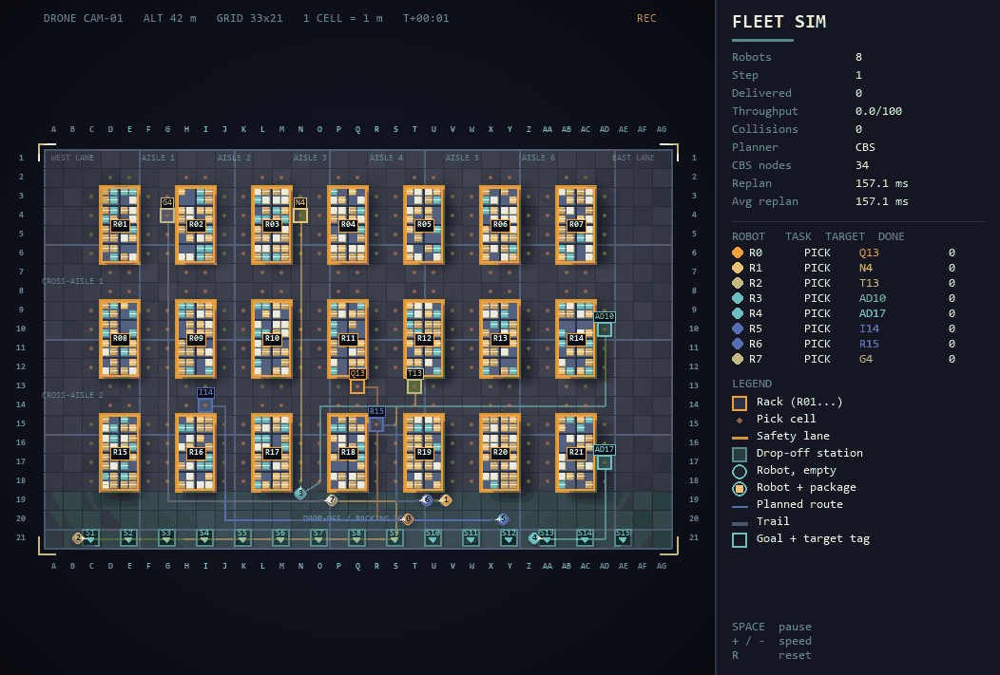

# Warehouse Fleet Sim

Real-time simulation of a robot fleet in an automated warehouse. Robots
continuously fetch items from shelves and deliver them to drop-off stations,
and every robot is guaranteed a **collision-free** route using
**Conflict-Based Search (CBS)** with a prioritized-planning fallback.



> Record your own GIF: `python main.py --save demo.gif`

## Features

- **Lifelong multi-agent path finding**: tasks never end; robots are re-planned whenever a new goal is assigned
- **Optimal CBS** (sum-of-costs) on top of **space-time A\*** with an exact BFS heuristic
- **Budgeted planning**: CBS has a node/time limit; if exceeded, the planner falls back to prioritized planning so the fleet never freezes
- **Live HUD**: throughput, collision counter (always 0), planner used, CBS nodes, replanning time
- **Smooth rendering**: interpolated motion, fading trails, planned routes, package indicators
- **GIF export** and **headless benchmark** modes
- Unit tests for conflict-freeness and head-on swaps

## Quick start

```bash
git clone https://github.com/Fazil/warehouse-fleet-sim.git
cd warehouse-fleet-sim
python -m venv .venv
.venv\Scripts\activate          # Windows  (Linux/macOS: source .venv/bin/activate)
pip install -r requirements.txt
python main.py
```

| Command | What it does |
|---|---|
| `python main.py --robots 12` | more robots (max 15 on the default map) |
| `python main.py --save demo.gif --steps 120` | export a GIF, no window needed |
| `python main.py --bench 1000 --robots 12` | headless benchmark |
| `python -m unittest discover tests` | run tests |

Controls: `SPACE` pause, `+` / `-` speed, `R` reset, `ESC` quit.

## How it works

1. **Map**: shelf blocks, 2-cell aisles, drop-off stations along the bottom edge.
2. **Task loop**: each robot alternates *pickup cell -> station*. Goals are unique so two robots never target the same cell.
3. **Low level**: space-time A\* over `(cell, time)` with wait actions, vertex/edge constraints, and a true-distance heuristic.
4. **High level**: CBS detects the first vertex or swap conflict, branches into two constraint sets, and re-plans only the affected robot.
5. **Fallback**: if CBS exceeds its budget, prioritized planning is used (random re-ordering on failure). If even that fails, robots wait one step and retry.

## Results

Default map (33x21), 1000 steps, seed 0, single CPU core:

| Robots | Delivered | Throughput (per 100 steps) | Avg replan | CBS solved | Collisions |
|---:|---:|---:|---:|---:|---:|
| 4  | 90  | 9.0  | 1.2 ms  | 170/170 | 0 |
| 8  | 185 | 18.5 | 5.2 ms  | 315/316 | 0 |
| 12 | 282 | 28.2 | 18.4 ms | 427/444 | 0 |
| 15 | 351 | 35.1 | 39.9 ms | 477/507 | 0 |

## Project structure

```
main.py               CLI, window loop, GIF export, benchmark
warehouse/grid.py     map, shelves, stations, BFS distance maps
warehouse/planner.py  space-time A*, CBS, prioritized fallback
warehouse/sim.py      robots, task assignment, replanning, metrics
warehouse/render.py   pygame renderer + HUD
tests/                unit tests
```

## Roadmap

- [ ] Battery / charging stations
- [ ] Enhanced CBS (conflict prioritization, bypass)
- [ ] Dynamic obstacles and robot breakdowns
- [ ] Compare against ECBS and PBS

## License

MIT
